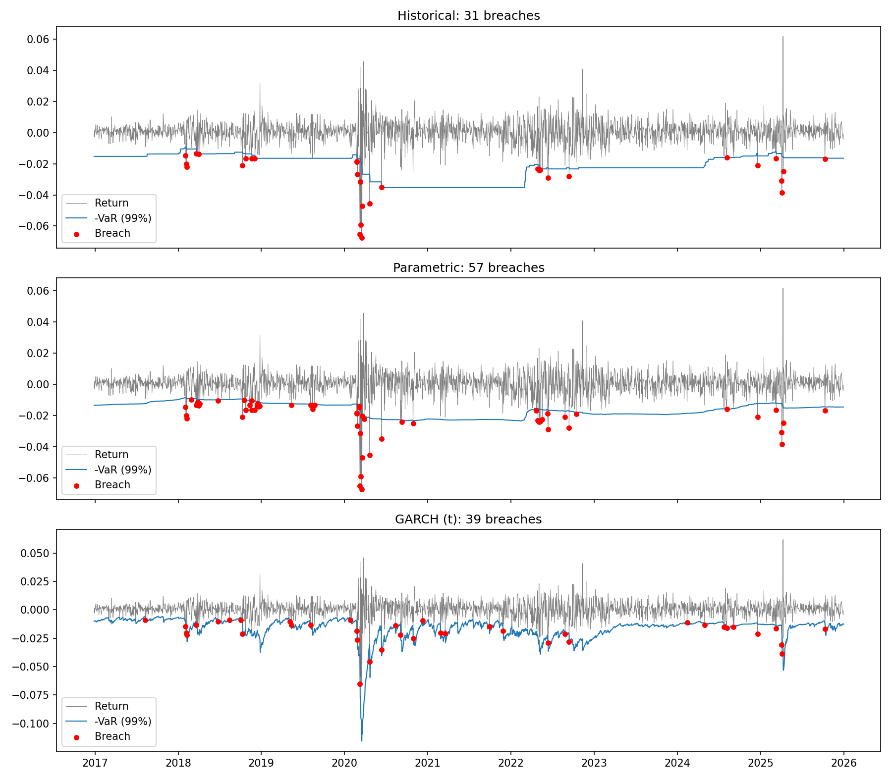

# VaR Model Validation
Python project backtesting four VaR methods on a five-asset portfolio (SPY, QQQ, IEF, GLD, USO).

## Key findings
- Returns are non-normal: Returns have an excess kurtosis of 12.59 and negative skew (-0.83), with the Jarque-Bera test rejecting normality (p < 0.01). This suggests that extreme losses are more likely to occur than expected under a normal distribution. 
- Historical VaR: Historical VaR had 31 clustered breaches (1.4%), while passing the Kupiec test (p = 0.09) and failing the Christoffersen test (p < 0.01).
- Parametric VaR: Parametric VaR failed both Kupiec and Christoffersen tests, experiencing 57 breaches (2.5%) clustered together. 
- GARCH VaR: GARCH(t) had independent breaches, but still had 39 breaches (1.7%), failing the Kupiec test (p < 0.01).
- Summary: No VaR model passed both backtests. Historical VaR got the right number of breaches but were clustered, GARCH spread its breaches out but had too many, and parametric VaR failed on both.

## Data and Setup
Daily adjusted closing prices for SPY, IEF, QQQ, GLD and USO (30/30/20/10/10) were downloaded from yfinance (January 2015 to December 2025) and combined into a portfolio. Each day's one day 99% VaR is estimated using the previous 500 trading days and compared with that day's actual return, resulting in 2,264 backtest observations. VaR is reported at 99% for backtesting and Expected Shortfall at 97.5%.

## Results (99% VaR, 2,264 test days)
| Model | Breaches (23 expected) | Kupiec test | Christoffersen test |
|---|---|---|---|
| Historical | 31 (1.4%) | Pass (p = 0.095) | Fail (p = 0.001) |
| Parametric | 57 (2.5%) | Fail (p < 0.001) | Fail (p < 0.001) |
| GARCH (t) | 39 (1.7%) | Fail (p = 0.002) | Pass (p = 0.18) |



## Methods
For this project various VaR methods (historical, parametric, Monte Carlo, GARCH) and Expected Shortfall are computed. Three of the methods were backtested (historical, parametric, and GARCH(t)) with a rolling window using Kupiec and Christoffersen tests for VaR forecast for the next day. The Monte Carlo model was not backtested because it uses the same normal distribution and assumptions as the Parametric VaR, therefore any differences in results are likely due to the random simulation than a different VaR method. Expected Shortfall is reported as a risk measure (97.5%, FRTB convention) but not backtested, since ES cannot be tested with the Kupiec and Christoffersen tests.

## Limitations
- Single portfolio and period. Results are for one fixed-weight portfolio over 2015 to 2025 and may differ for other portfolios or periods.
- One-day horizon. VaR is not scaled to longer or FRTB liquidity horizons.
- Limited statistical power. Only about 23 breaches are expected at 99% in 2,264 test days, so the backtests cannot distinguish models with great confidence.
- Fixed model choices. All models use a 500-day window, and GARCH is limited to a constant-mean GARCH(1,1), so other settings might perform differently.

## Tools
- Python
- NumPy
- Pandas
- yfinance
- SciPy
- Matplotlib
- Jupyter
- arch 

## How to run 
1. Clone or download this repo.
2. Create and activate a virtual environment:
```bash
python3 -m venv .venv
source .venv/bin/activate #windows: .venv/Scripts/Activate
```
3. Install the dependencies:
   ```bash
   pip install -r requirements.txt
   ```
4. Open `analysis.ipynb`, and select the `.venv` environment as the notebook kernel, and then run all cells. Prices are downloaded from Yahoo Finance, so an internet connection is needed, and the full backtest takes a few minutes.

## Use your own portfolio
Instead of using the default portfolio, you can implement your own portfolio by editing the tickers and weights. Additionally you can set your own time range. 
This can be done within the setup cell in `analysis.ipynb`, by running this cell with desired tickers, weights, and dates:
```python
tickers = ["SPY", "IEF", "QQQ", "GLD", "USO"] #update tickers here
data = load_prices(tickers, start="2015-01-01", end="2025-12-31") #update dates here

returns = calculate_returns(data, { #update tickers and weights here
    "SPY": 0.3,
    "IEF": 0.3,
    "QQQ": 0.2,
    "GLD": 0.1,
    "USO": 0.1})
```

- Weights must sum to 1, and every ticker in the weights must also be in `tickers`.
- Any Yahoo Finance ticker works.
- Dates are in `YYYY-MM-DD` format. 
- Use minimum 3 years of data (5+ recommended), the first 500 trading days are used for the initial forecast, so only later days are backtested. Every ticker must also have price history covering the full date range.
- The results and findings above are for the default portfolio and will change with yours.


## Project structure
```
var-model-validation/
├── analysis.ipynb        # full analysis: statistics, VaR/ES, backtests, charts
├── risk/
│   ├── data/
│   │   └── data.py       # price download and return calculations
│   ├── stats.py          # return statistics and normality tests
│   ├── var.py            # historical, parametric, Monte Carlo, and GARCH VaR
│   ├── es.py             # expected shortfall estimators
│   └── backtest.py       # rolling backtest, Kupiec and Christoffersen tests
├── results/
│   ├── breaches.png      # breach charts
│   └── report.html       # exported report
├── requirements.txt
└── LICENSE
```